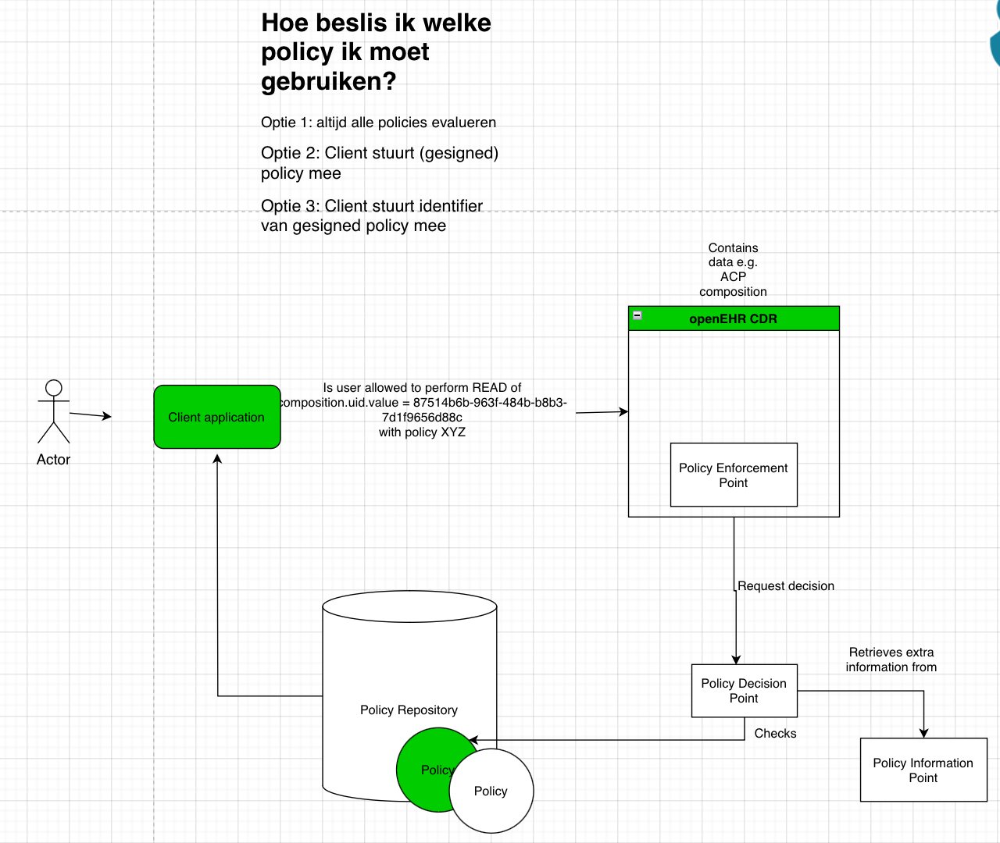

# Authorisation

An experiment to express access control policy (authorisations) for openEHR data,
based on Nuts verifiable credentials. It addresses
[upstream issue #11](https://github.com/jorritspee/openEHRxNuts/issues/11). The first
OPA/Rego draft was contributed in
[upstream PR #14](https://github.com/jorritspee/openEHRxNuts/pull/14);
[authorisation_design.md](https://github.com/joostholslag-claude/openEHRxNuts/blob/main/Authorisation/authorisation_design.md) (in Dutch) reviews that draft and proposes how to standardise
the evaluation input, the resource scope and the policy format.

## Contents

| Path | What |
|---|---|
| [`policies/rules/openEHR_template_id.rego`](policies/rules/openEHR_template_id.rego) | Generic Rego rule: `allow` is true when both the template id and the user role are allowed for the requested operation |
| [`policies/datasources/acp_access_policy_for_rego.json`](policies/datasources/acp_access_policy_for_rego.json) | The ACP-specific data the rule reads: allowed template ids and user roles per operation |
| [`policies/openehr_tests/openehr_template_test.rego`](policies/openehr_tests/openehr_template_test.rego) | Unit tests for the rule |
| [`access_policy.rego.schema.json`](access_policy.rego.schema.json) | JSON Schema (draft-07) for the datasource file. This is the contract between the policy data and the engine: it fixes the structure the Rego rule reads, so the JSON can be edited and validated without knowing Rego, and an authorisation engine that is not Rego-based can implement the same contract |
| [`docs/`](docs/) | Architecture diagram (draw.io source and PNG) and a screenshot of an early version of the policy |
| [`authorisation_design.md`](https://github.com/joostholslag-claude/openEHRxNuts/blob/main/Authorisation/authorisation_design.md) | Design proposal for issue #11 (in Dutch) |

## Running the checks locally

You need the [OPA](https://www.openpolicyagent.org/docs/#running-opa) binary (1.x)
and [pipx](https://pipx.pypa.io/). Run everything from the repository root:

```sh
opa fmt --fail --list Authorisation/policies
opa check --strict Authorisation/policies
opa test Authorisation/policies -v
pipx run "check-jsonschema<1" \
  --schemafile Authorisation/access_policy.rego.schema.json \
  Authorisation/policies/datasources/acp_access_policy_for_rego.json
```

The same checks run in CI on every push and pull request, see
[`.github/workflows/authorisation-policies.yml`](../.github/workflows/authorisation-policies.yml).

## Architecture



The diagram source is [`docs/authorisation_architecture_overview.drawio`](docs/authorisation_architecture_overview.drawio) (edit with [draw.io](https://app.diagrams.net)). The question in the diagram, which policy applies to a request, is answered in [authorisation_design.md](https://github.com/joostholslag-claude/openEHRxNuts/blob/main/Authorisation/authorisation_design.md), section 7.5. `docs/` also keeps a [screenshot](docs/authorisation_rego_playground_screenshot.jpg) of an early version of the policy in the Rego Playground, for historical reference.
